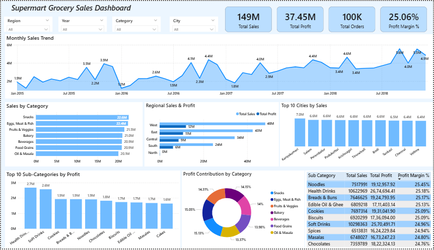

# Supermart Grocery Sales Dashboard

## Project Overview
This project is an interactive Power BI dashboard developed to analyze Supermart grocery sales data and understand overall business performance.

The dashboard provides insights into sales, profit, product categories, regional performance, and city-wise sales through interactive visualizations and slicers.

## Dashboard Preview



## Project Objectives
- Analyze total sales, total profit, total orders, and profit margin.
- Understand monthly sales trends.
- Compare sales across product categories and regions.
- Identify top-performing cities and sub-categories.
- Explore business performance using interactive filters.

## Tools Used
- Microsoft Power BI Desktop
- Power Query
- DAX

## Key Performance Indicators (KPIs)
- **Total Sales:** 149M
- **Total Profit:** 37.45M
- **Total Orders:** 100K
- **Profit Margin:** 25.06%

## Dashboard Features
- Monthly Sales Trend
- Sales by Category
- Regional Sales & Profit
- Top 10 Cities by Sales
- Top 10 Sub-Categories by Profit
- Profit Contribution by Category
- Sub-category Sales, Profit, and Profit Margin Details
- Interactive slicers for Year, Region, Category, and City

## Repository Structure

```text
Supermart-Grocery-Sales-Dashboard/
├── Dashboard/
    └── Supermart Grocery Sales Dashboard.pbix
├── Dataset/
    └── Supermart_Grocery_Sales_Data.csv
├── Documentation/
    └── Project_Report.docx
    └── Business Questions
├── Screenshot/
│   └── Dashboard_picture.png
└── README.md
```

## Conclusion
This project demonstrates how Power BI can transform grocery sales data into an interactive dashboard. It helps users monitor key performance indicators, compare business segments, and identify important sales and profit trends.


